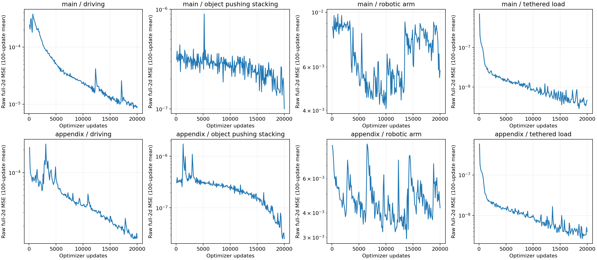
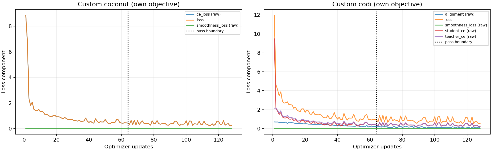

# P11 measured deadline study

**All frozen answer-generation conditions were attempted. Failed outputs remain in the reported denominators.**

Report snapshot UTC: 2026-09-26 03:19:05. Base/current commit `d2e9fe3daba63cc0b5295fa108177628c4319098`, branch `full-phi-jepa-from-dataset`. P11 source changes are local and uncommitted; exact source/configuration blobs are archived in the native run and exported manifests. P10 evidence remains unchanged.

Main comparison: 60 trajectories/domain, 48 train and 12 original sealed test_id; eight separate validation trajectories/domain select Phi-JEPA checkpoints. One predefined earliest-horizon question per trajectory, SHA256 scenario order, seed 11. Appendix: 20/domain, 16 train and four nested test trajectories. No held-out checkpoint selection in the appendix. Exact identities are in selection.json and plan.json.

The appendix is a small, one-seed exploratory comparison with limited training exposure. These results may not generalize to larger samples; larger-scale comparisons remain future work. Coconut and CODI are the approved notebook-derived custom implementations, not official reproductions. The custom models share one backbone across domains within each independently trained method; Phi-JEPA has separate accepted-layout models per domain. Equal data does not imply capacity or update matching.

## Main answer results

| Domain | Method | Typed valid/Q | Complete/Q | Numeric correct/eligible | Boolean correct/eligible | Unsupported | Failed targets |
| --- | --- | --- | --- | --- | --- | --- | --- |
| driving | Phi-JEPA | 12/12 | 0/12 | 0/24 | 11/12 | 0 | 0 |
| driving | gpt-5.6-sol direct | 12/12 | 1/12 | 3/24 | 12/12 | 0 | 0 |
| object_pushing_stacking | Phi-JEPA | 12/12 | 0/12 | 25/48 | 12/36 | 24 | 0 |
| object_pushing_stacking | gpt-5.6-sol direct | 12/12 | 12/12 | 48/48 | 36/36 | 0 | 0 |
| robotic_arm | Phi-JEPA | 12/12 | 0/12 | 0/60 | 8/12 | 0 | 0 |
| robotic_arm | gpt-5.6-sol direct | 1/12 | 0/12 | 1/60 | 1/12 | 0 | 66 |
| tethered_load | Phi-JEPA | 12/12 | 9/12 | 31/36 | 10/12 | 2 | 0 |
| tethered_load | gpt-5.6-sol direct | 11/12 | 9/12 | 33/36 | 9/12 | 0 | 4 |

## Matched appendix answer results

| Domain | Method | Typed valid/Q | Complete/Q | Numeric correct/eligible | Boolean correct/eligible | Unsupported | Failed targets |
| --- | --- | --- | --- | --- | --- | --- | --- |
| driving | Phi-JEPA | 4/4 | 0/4 | 0/8 | 3/4 | 0 | 0 |
| driving | custom Coconut | 1/4 | 0/4 | 0/8 | 0/4 | 0 | 9 |
| driving | custom CODI student | 4/4 | 0/4 | 0/8 | 3/4 | 0 | 0 |
| object_pushing_stacking | Phi-JEPA | 4/4 | 0/4 | 0/16 | 4/12 | 8 | 0 |
| object_pushing_stacking | custom Coconut | 0/4 | 0/4 | 0/16 | 0/12 | 0 | 28 |
| object_pushing_stacking | custom CODI student | 0/4 | 0/4 | 0/16 | 0/12 | 0 | 28 |
| robotic_arm | Phi-JEPA | 4/4 | 0/4 | 0/20 | 2/4 | 0 | 0 |
| robotic_arm | custom Coconut | 0/4 | 0/4 | 0/20 | 0/4 | 0 | 24 |
| robotic_arm | custom CODI student | 0/4 | 0/4 | 0/20 | 0/4 | 0 | 24 |
| tethered_load | Phi-JEPA | 4/4 | 0/4 | 5/12 | 4/4 | 0 | 0 |
| tethered_load | custom Coconut | 0/4 | 0/4 | 0/12 | 0/4 | 0 | 16 |
| tethered_load | custom CODI student | 0/4 | 0/4 | 0/12 | 0/4 | 0 | 16 |

Every requested target remains in the denominator. Unsupported contact outcomes and missing/failed generations count against complete-answer success. Typed validity is envelope/parser success, not answer accuracy. The direct gpt-5.6-sol condition can attempt all Boolean outputs from public information; Phi-JEPA retains its qualified deterministic Boolean readout. Its 0.02-second sampling does not establish exact continuous-time event recovery. P10 Boolean-restricted public-only results are historical and not pooled with this condition. No strict-parser output is repaired. Phi-JEPA uses the frozen gpt-5.6-sol answer layer; the custom methods generate their own typed answers with Flan-T5-small, so this is not a capacity-matched comparison.

## Exposure and checkpoint policy

| Cohort | Domain | Method | Examples | Updates | Pair passes / complete text passes | Selected |
| --- | --- | --- | --- | --- | --- | --- |
| main | driving | Phi-JEPA | 48 | 20000 | 92.593 | 5000 |
| main | object_pushing_stacking | Phi-JEPA | 48 | 20000 | 208.333 | 10000 |
| main | robotic_arm | Phi-JEPA | 48 | 20000 | 208.333 | 5000 |
| main | tethered_load | Phi-JEPA | 48 | 20000 | 208.333 | 20000 |
| appendix | driving | Phi-JEPA | 16 | 20000 | 277.778 | 20000 |
| appendix | object_pushing_stacking | Phi-JEPA | 16 | 20000 | 625.0 | 20000 |
| appendix | robotic_arm | Phi-JEPA | 16 | 20000 | 625.0 | 20000 |
| appendix | tethered_load | Phi-JEPA | 16 | 20000 | 625.0 | 20000 |
| appendix | all four | coconut | 64 | 128 | 2 | final second pass |
| appendix | all four | codi | 64 | 128 | 2 | final second pass |

Primary training retains frozen Qwen, trainable P, numerical width d/context width d, raw full-2d adjacent MSE with both current-p gradient paths, training-only frozen input conditioning, the existing supervised mean-derivative bias initialization, physical RK4 time and complete predicted-vector feedback. Main selection uses only separate validation at 5k/10k/20k; appendix final 20k is fixed. Custom objectives, branch/inventory instructions, shared CODI backbone and latent paths are unchanged from P10; both custom runs start fresh and use two full shuffled passes. Training-example milestone generations are fitting diagnostics and remain separate from test scores.

Models: Qwen/Qwen3-Embedding-0.6B revision `97b0c614be4d77ee51c0cef4e5f07c00f9eb65b3`; custom google/flan-t5-small revision `0fc9ddf78a1e988dac52e2dac162b0ede4fd74ab`; actual configured hosted model `gpt-5.6-sol` for enrichment and answer conditions. Returned service model/response IDs are recorded; no immutable hosted revision is exposed. Custom inputs are never silently truncated; max input 32768, targets 2048, generation 2048, greedy.

## Resource accounting

| Metric | Measured |
| --- | --- |
| GPU worker minutes | 120.115 |
| CPU worker wall minutes | 37.913 |
| Provider request elapsed minutes (overlaps local) | 45.372 |
| API attempts | 344 |
| Input tokens charged | 3997538 |
| Output tokens charged | 200708 |
| USD conservative metered estimate | 24.00185 |
| Unknown usage attempts | 0 |
| Overall elapsed minutes | 144.869 |

Local GPU worker wall includes model loading/inference/checkpoint IO, one GPU worker. CPU worker wall is separate, overlaps GPU/API; provider CPU process time separately. Vendor GPU compute is not exposed. Script development/interactive orchestration is included in overall elapsed time but excluded from execution-resource metrics. Failed operations included; USD is conservative metered estimate, not invoice.

## Completion matrix

| Cohort | Domain | Work | Status | Updates | Selected |
| --- | --- | --- | --- | --- | --- |
| main | driving | Phi-JEPA training | complete | 20000 | 5000 |
| main | object_pushing_stacking | Phi-JEPA training | complete | 20000 | 10000 |
| main | robotic_arm | Phi-JEPA training | complete | 20000 | 5000 |
| main | tethered_load | Phi-JEPA training | complete | 20000 | 20000 |
| appendix | driving | Phi-JEPA training | complete | 20000 | 20000 |
| appendix | object_pushing_stacking | Phi-JEPA training | complete | 20000 | 20000 |
| appendix | robotic_arm | Phi-JEPA training | complete | 20000 | 20000 |
| appendix | tethered_load | Phi-JEPA training | complete | 20000 | 20000 |
| appendix | all four | coconut training | complete | 128 | 128 |
| appendix | all four | codi training | complete | 128 | 128 |
| main | driving | Phi-JEPA generation | finished; 12/12 typed valid | — | — |
| main | driving | gpt-5.6-sol direct generation | finished; 12/12 typed valid | — | — |
| appendix | driving | Phi-JEPA generation | finished; 4/4 typed valid | — | — |
| appendix | driving | custom Coconut generation | finished_with_failures; 1/4 typed valid | — | — |
| appendix | driving | custom CODI student generation | finished; 4/4 typed valid | — | — |
| main | object_pushing_stacking | Phi-JEPA generation | finished; 12/12 typed valid | — | — |
| main | object_pushing_stacking | gpt-5.6-sol direct generation | finished; 12/12 typed valid | — | — |
| appendix | object_pushing_stacking | Phi-JEPA generation | finished; 4/4 typed valid | — | — |
| appendix | object_pushing_stacking | custom Coconut generation | finished_with_failures; 0/4 typed valid | — | — |
| appendix | object_pushing_stacking | custom CODI student generation | finished_with_failures; 0/4 typed valid | — | — |
| main | robotic_arm | Phi-JEPA generation | finished; 12/12 typed valid | — | — |
| main | robotic_arm | gpt-5.6-sol direct generation | finished_with_failures; 1/12 typed valid | — | — |
| appendix | robotic_arm | Phi-JEPA generation | finished; 4/4 typed valid | — | — |
| appendix | robotic_arm | custom Coconut generation | finished_with_failures; 0/4 typed valid | — | — |
| appendix | robotic_arm | custom CODI student generation | finished_with_failures; 0/4 typed valid | — | — |
| main | tethered_load | Phi-JEPA generation | finished; 12/12 typed valid | — | — |
| main | tethered_load | gpt-5.6-sol direct generation | finished_with_failures; 11/12 typed valid | — | — |
| appendix | tethered_load | Phi-JEPA generation | finished; 4/4 typed valid | — | — |
| appendix | tethered_load | custom Coconut generation | finished_with_failures; 0/4 typed valid | — | — |
| appendix | tethered_load | custom CODI student generation | finished_with_failures; 0/4 typed valid | — | — |

Deferred: new ablation retraining, CODI hybrid/teacher evaluation, calibrated OOD detection, human clarification evaluation, larger custom cohort. Calibration remains unavailable when required assessment components are absent; partial development familiarity is not calibrated OOD recognition. Human-reviewed clarification is separate and was not activated in unattended evaluation. stable_stack/support_lost remain unsupported by Phi-JEPA where predictive contact evidence is missing. No physics formulas, contact channels, heads, schema repair, learned EBM or inference optimization were added.

Evidence: evaluation/answers.json retains every target status and failure; physical_by_time.json and physical_summary.json retain named errors and matched hold-last diagnostics (a diagnostic, not a new paper baseline); evaluation/diagnostics contains coordinate groups and one-step/autonomous errors for two fixed training questions/domain and every frozen test question. Model histories retain every update/loss component; custom saved envelopes retain strict parsing/EOS outcomes; resources.json and operations retain failed work. Native checkpoints and source blobs are preserved.

The [endpoint errors](artifacts/P11/evaluation/endpoint_error_summary.csv) compare named requested numerical quantities for every answer condition and the independent numerical readout. RMSE there uses valid outputs only, with invalid/unsupported counts beside it; it must not replace the all-question accuracy denominator. The [time-resolved errors](artifacts/P11/evaluation/physical_by_time.csv) and [coordinate groups](artifacts/P11/evaluation/coordinate_groups.csv) retain scenario/time detail.

## Frozen question coverage

| Domain | Requested quantities | End time (s) | Main train Q | Selection Q | Test Q |
| --- | --- | --- | --- | --- | --- |
| driving | forward_position, forward_velocity, stopped_by_T | 2.0 | 48 | 8 | 12 |
| object_pushing_stacking | left_table, orientation, position, stable_stack, support_lost | 1.0 | 48 | 8 | 12 |
| robotic_arm | angle, angular_velocity, joint_limit_by_T, position | 1.0 | 48 | 8 | 12 |
| tethered_load | angular_velocity, boundary_crossed, position, swing_angle | 1.0 | 48 | 8 | 12 |

Every scenario contributes one predefined question. Scenario IDs, original partitions and appendix membership are retained in selection.json; target-level coverage is in question_coverage.json. The earliest-horizon rule was fixed without inspecting outcomes. It does not sample all task types, and the nearly stationary object trajectories in this selected interval do not establish performance on harder contact dynamics.

## Measured training cost by condition

| Cohort | Domain | Method | Training-loop wall min |
| --- | --- | --- | --- |
| main | driving | Phi-JEPA | 4.31 |
| main | object_pushing_stacking | Phi-JEPA | 3.273 |
| main | robotic_arm | Phi-JEPA | 4.927 |
| main | tethered_load | Phi-JEPA | 4.143 |
| appendix | driving | Phi-JEPA | 4.042 |
| appendix | object_pushing_stacking | Phi-JEPA | 3.176 |
| appendix | robotic_arm | Phi-JEPA | 4.825 |
| appendix | tethered_load | Phi-JEPA | 4.169 |
| appendix | all four | coconut | 34.69 |
| appendix | all four | codi | 74.762 |

These training-loop durations are included within the worker totals above, not added to them. Worker totals also include model loading, generation, checkpoint IO and the discarded timing probe. Custom training-loop time includes the predefined training-example generation checks. Exact pair/sample exposure is retained in exposure.json and histories. Numerical exposure totals count all executed training; a selected earlier checkpoint contains only its preceding updates. exposure.json separately records that selected-checkpoint exposure.

## Full-horizon named physical errors

| Cohort | Domain | Method | Quantity | Unit | RMSE | Valid/eligible |
| --- | --- | --- | --- | --- | --- | --- |
| main | driving | hold_last_diagnostic | car.position | m | 1.81437 | 1080/1080 |
| main | driving | hold_last_diagnostic | car.orientation | rad | 0.00048723 | 1080/1080 |
| main | driving | hold_last_diagnostic | car.velocity | m/s | 0.793802 | 1080/1080 |
| main | driving | hold_last_diagnostic | car.angular_velocity | rad/s | 0.0283094 | 1080/1080 |
| main | driving | hold_last_diagnostic | car.forward_position | m | 1.81437 | 1080/1080 |
| main | driving | hold_last_diagnostic | car.forward_velocity | m/s | 0.79374 | 1080/1080 |
| main | driving | hold_last_diagnostic | wheel_0.angle | rad | 17.9946 | 1080/1080 |
| main | driving | hold_last_diagnostic | wheel_0.angular_velocity | rad/s | 7.88162 | 1080/1080 |
| main | driving | hold_last_diagnostic | wheel_1.angle | rad | 17.9946 | 1080/1080 |
| main | driving | hold_last_diagnostic | wheel_1.angular_velocity | rad/s | 7.88165 | 1080/1080 |
| main | driving | hold_last_diagnostic | wheel_2.angle | rad | 17.9941 | 1080/1080 |
| main | driving | hold_last_diagnostic | wheel_2.angular_velocity | rad/s | 7.88139 | 1080/1080 |
| main | driving | hold_last_diagnostic | wheel_3.angle | rad | 17.9941 | 1080/1080 |
| main | driving | hold_last_diagnostic | wheel_3.angular_velocity | rad/s | 7.88141 | 1080/1080 |
| appendix | driving | hold_last_diagnostic | car.position | m | 1.8534 | 360/360 |
| appendix | driving | hold_last_diagnostic | car.orientation | rad | 0.000481187 | 360/360 |
| appendix | driving | hold_last_diagnostic | car.velocity | m/s | 0.799906 | 360/360 |
| appendix | driving | hold_last_diagnostic | car.angular_velocity | rad/s | 0.030284 | 360/360 |
| appendix | driving | hold_last_diagnostic | car.forward_position | m | 1.8534 | 360/360 |
| appendix | driving | hold_last_diagnostic | car.forward_velocity | m/s | 0.799844 | 360/360 |
| appendix | driving | hold_last_diagnostic | wheel_0.angle | rad | 18.3816 | 360/360 |
| appendix | driving | hold_last_diagnostic | wheel_0.angular_velocity | rad/s | 7.92693 | 360/360 |
| appendix | driving | hold_last_diagnostic | wheel_1.angle | rad | 18.3816 | 360/360 |
| appendix | driving | hold_last_diagnostic | wheel_1.angular_velocity | rad/s | 7.92591 | 360/360 |
| appendix | driving | hold_last_diagnostic | wheel_2.angle | rad | 18.3807 | 360/360 |
| appendix | driving | hold_last_diagnostic | wheel_2.angular_velocity | rad/s | 7.92699 | 360/360 |
| appendix | driving | hold_last_diagnostic | wheel_3.angle | rad | 18.3808 | 360/360 |
| appendix | driving | hold_last_diagnostic | wheel_3.angular_velocity | rad/s | 7.92591 | 360/360 |
| main | driving | Phi-JEPA | car.position | m | 0.460276 | 1080/1080 |
| main | driving | Phi-JEPA | car.orientation | rad | 0.220606 | 1080/1080 |
| main | driving | Phi-JEPA | car.velocity | m/s | 0.392734 | 1080/1080 |
| main | driving | Phi-JEPA | car.angular_velocity | rad/s | 0.881462 | 1080/1080 |
| main | driving | Phi-JEPA | car.forward_position | m | 0.429345 | 1080/1080 |
| main | driving | Phi-JEPA | car.forward_velocity | m/s | 0.139558 | 1080/1080 |
| main | driving | Phi-JEPA | wheel_0.angle | rad | 4.60185 | 1080/1080 |
| main | driving | Phi-JEPA | wheel_0.angular_velocity | rad/s | 1.28541 | 1080/1080 |
| main | driving | Phi-JEPA | wheel_1.angle | rad | 4.60166 | 1080/1080 |
| main | driving | Phi-JEPA | wheel_1.angular_velocity | rad/s | 1.28574 | 1080/1080 |
| main | driving | Phi-JEPA | wheel_2.angle | rad | 4.60117 | 1080/1080 |
| main | driving | Phi-JEPA | wheel_2.angular_velocity | rad/s | 1.28478 | 1080/1080 |
| main | driving | Phi-JEPA | wheel_3.angle | rad | 4.60152 | 1080/1080 |
| main | driving | Phi-JEPA | wheel_3.angular_velocity | rad/s | 1.29098 | 1080/1080 |
| appendix | driving | Phi-JEPA | car.position | m | 2.34179 | 360/360 |
| appendix | driving | Phi-JEPA | car.orientation | rad | 1.21888 | 360/360 |
| appendix | driving | Phi-JEPA | car.velocity | m/s | 2.84546 | 360/360 |
| appendix | driving | Phi-JEPA | car.angular_velocity | rad/s | 3.11474 | 360/360 |
| appendix | driving | Phi-JEPA | car.forward_position | m | 2.20821 | 360/360 |
| appendix | driving | Phi-JEPA | car.forward_velocity | m/s | 0.54838 | 360/360 |
| appendix | driving | Phi-JEPA | wheel_0.angle | rad | 21.475 | 360/360 |
| appendix | driving | Phi-JEPA | wheel_0.angular_velocity | rad/s | 12.6536 | 360/360 |
| appendix | driving | Phi-JEPA | wheel_1.angle | rad | 21.4755 | 360/360 |
| appendix | driving | Phi-JEPA | wheel_1.angular_velocity | rad/s | 12.6835 | 360/360 |
| appendix | driving | Phi-JEPA | wheel_2.angle | rad | 21.4724 | 360/360 |
| appendix | driving | Phi-JEPA | wheel_2.angular_velocity | rad/s | 12.5854 | 360/360 |
| appendix | driving | Phi-JEPA | wheel_3.angle | rad | 21.4707 | 360/360 |
| appendix | driving | Phi-JEPA | wheel_3.angular_velocity | rad/s | 12.6673 | 360/360 |
| main | object_pushing_stacking | hold_last_diagnostic | block_1.position | m | 0.00500143 | 480/480 |
| main | object_pushing_stacking | hold_last_diagnostic | block_1.orientation | rad | 5.81196e-05 | 480/480 |
| main | object_pushing_stacking | hold_last_diagnostic | block_1.velocity | m/s | 0.0208176 | 480/480 |
| main | object_pushing_stacking | hold_last_diagnostic | block_1.angular_velocity | rad/s | 0.000575501 | 480/480 |
| main | object_pushing_stacking | hold_last_diagnostic | block_2.position | m | 1.29777e-05 | 480/480 |
| main | object_pushing_stacking | hold_last_diagnostic | block_2.orientation | rad | 2.72883e-05 | 480/480 |
| main | object_pushing_stacking | hold_last_diagnostic | block_2.velocity | m/s | 5.4474e-05 | 480/480 |
| main | object_pushing_stacking | hold_last_diagnostic | block_2.angular_velocity | rad/s | 0.000254336 | 480/480 |
| appendix | object_pushing_stacking | hold_last_diagnostic | block_1.position | m | 1.11645e-05 | 160/160 |
| appendix | object_pushing_stacking | hold_last_diagnostic | block_1.orientation | rad | 7.07278e-05 | 160/160 |
| appendix | object_pushing_stacking | hold_last_diagnostic | block_1.velocity | m/s | 3.242e-05 | 160/160 |
| appendix | object_pushing_stacking | hold_last_diagnostic | block_1.angular_velocity | rad/s | 0.000512896 | 160/160 |
| appendix | object_pushing_stacking | hold_last_diagnostic | block_2.position | m | 1.33981e-05 | 160/160 |
| appendix | object_pushing_stacking | hold_last_diagnostic | block_2.orientation | rad | 1.68172e-05 | 160/160 |
| appendix | object_pushing_stacking | hold_last_diagnostic | block_2.velocity | m/s | 5.53447e-05 | 160/160 |
| appendix | object_pushing_stacking | hold_last_diagnostic | block_2.angular_velocity | rad/s | 0.000253895 | 160/160 |
| main | object_pushing_stacking | Phi-JEPA | block_1.position | m | 0.00859449 | 480/480 |
| main | object_pushing_stacking | Phi-JEPA | block_1.orientation | rad | 0.00818472 | 480/480 |
| main | object_pushing_stacking | Phi-JEPA | block_1.velocity | m/s | 0.0470197 | 480/480 |
| main | object_pushing_stacking | Phi-JEPA | block_1.angular_velocity | rad/s | 0.00441474 | 480/480 |
| main | object_pushing_stacking | Phi-JEPA | block_2.position | m | 0.00363129 | 480/480 |
| main | object_pushing_stacking | Phi-JEPA | block_2.orientation | rad | 0.00906236 | 480/480 |
| main | object_pushing_stacking | Phi-JEPA | block_2.velocity | m/s | 0.00321349 | 480/480 |
| main | object_pushing_stacking | Phi-JEPA | block_2.angular_velocity | rad/s | 0.00230081 | 480/480 |
| appendix | object_pushing_stacking | Phi-JEPA | block_1.position | m | 0.0491227 | 160/160 |
| appendix | object_pushing_stacking | Phi-JEPA | block_1.orientation | rad | 0.113931 | 160/160 |
| appendix | object_pushing_stacking | Phi-JEPA | block_1.velocity | m/s | 2.17085 | 160/160 |
| appendix | object_pushing_stacking | Phi-JEPA | block_1.angular_velocity | rad/s | 0.0579177 | 160/160 |
| appendix | object_pushing_stacking | Phi-JEPA | block_2.position | m | 0.0427818 | 160/160 |
| appendix | object_pushing_stacking | Phi-JEPA | block_2.orientation | rad | 0.0550711 | 160/160 |
| appendix | object_pushing_stacking | Phi-JEPA | block_2.velocity | m/s | 0.0387142 | 160/160 |
| appendix | object_pushing_stacking | Phi-JEPA | block_2.angular_velocity | rad/s | 0.0291592 | 160/160 |
| main | robotic_arm | hold_last_diagnostic | joint_1.angle | rad | 1.72627 | 480/480 |
| main | robotic_arm | hold_last_diagnostic | joint_1.angular_velocity | rad/s | 4.15631 | 480/480 |
| main | robotic_arm | hold_last_diagnostic | joint_2.angle | rad | 1.20164 | 480/480 |
| main | robotic_arm | hold_last_diagnostic | joint_2.angular_velocity | rad/s | 6.34943 | 480/480 |
| main | robotic_arm | hold_last_diagnostic | tip.position | m | 0.977156 | 480/480 |
| appendix | robotic_arm | hold_last_diagnostic | joint_1.angle | rad | 1.60764 | 160/160 |
| appendix | robotic_arm | hold_last_diagnostic | joint_1.angular_velocity | rad/s | 4.16715 | 160/160 |
| appendix | robotic_arm | hold_last_diagnostic | joint_2.angle | rad | 1.03452 | 160/160 |
| appendix | robotic_arm | hold_last_diagnostic | joint_2.angular_velocity | rad/s | 5.96175 | 160/160 |
| appendix | robotic_arm | hold_last_diagnostic | tip.position | m | 0.956677 | 160/160 |
| main | robotic_arm | Phi-JEPA | joint_1.angle | rad | 0.727465 | 480/480 |
| main | robotic_arm | Phi-JEPA | joint_1.angular_velocity | rad/s | 7.83515 | 480/480 |
| main | robotic_arm | Phi-JEPA | joint_2.angle | rad | 0.685818 | 480/480 |
| main | robotic_arm | Phi-JEPA | joint_2.angular_velocity | rad/s | 28.5359 | 480/480 |
| main | robotic_arm | Phi-JEPA | tip.position | m | 0.55016 | 480/480 |
| appendix | robotic_arm | Phi-JEPA | joint_1.angle | rad | 0.565614 | 160/160 |
| appendix | robotic_arm | Phi-JEPA | joint_1.angular_velocity | rad/s | 10.6354 | 160/160 |
| appendix | robotic_arm | Phi-JEPA | joint_2.angle | rad | 0.937017 | 160/160 |
| appendix | robotic_arm | Phi-JEPA | joint_2.angular_velocity | rad/s | 46.4172 | 160/160 |
| appendix | robotic_arm | Phi-JEPA | tip.position | m | 0.727563 | 160/160 |
| main | tethered_load | hold_last_diagnostic | load.position | m | 0.0996024 | 480/480 |
| main | tethered_load | hold_last_diagnostic | load.swing_angle | rad | 0.143208 | 480/480 |
| main | tethered_load | hold_last_diagnostic | load.angular_velocity | rad/s | 0.262832 | 480/480 |
| main | tethered_load | hold_last_diagnostic | support.position | m | 0.00237411 | 480/480 |
| main | tethered_load | hold_last_diagnostic | support.velocity | m/s | 0.0099283 | 480/480 |
| appendix | tethered_load | hold_last_diagnostic | load.position | m | 0.0754065 | 160/160 |
| appendix | tethered_load | hold_last_diagnostic | load.swing_angle | rad | 0.122108 | 160/160 |
| appendix | tethered_load | hold_last_diagnostic | load.angular_velocity | rad/s | 0.264822 | 160/160 |
| appendix | tethered_load | hold_last_diagnostic | support.position | m | 0.00227265 | 160/160 |
| appendix | tethered_load | hold_last_diagnostic | support.velocity | m/s | 0.0092228 | 160/160 |
| main | tethered_load | Phi-JEPA | load.position | m | 0.00415413 | 480/480 |
| main | tethered_load | Phi-JEPA | load.swing_angle | rad | 0.00425976 | 480/480 |
| main | tethered_load | Phi-JEPA | load.angular_velocity | rad/s | 0.0265565 | 480/480 |
| main | tethered_load | Phi-JEPA | support.position | m | 0.00053361 | 480/480 |
| main | tethered_load | Phi-JEPA | support.velocity | m/s | 0.00636978 | 480/480 |
| appendix | tethered_load | Phi-JEPA | load.position | m | 0.00621001 | 160/160 |
| appendix | tethered_load | Phi-JEPA | load.swing_angle | rad | 0.00387677 | 160/160 |
| appendix | tethered_load | Phi-JEPA | load.angular_velocity | rad/s | 0.0251035 | 160/160 |
| appendix | tethered_load | Phi-JEPA | support.position | m | 0.000687 | 160/160 |
| appendix | tethered_load | Phi-JEPA | support.velocity | m/s | 0.00808215 | 160/160 |

## Unsupported requested outputs

| Cohort | Domain | Method | Target | Reason | Count |
| --- | --- | --- | --- | --- | --- |
| main | object_pushing_stacking | Phi-JEPA | block_2:stable_stack | missing_contact_force_and_history | 12 |
| main | object_pushing_stacking | Phi-JEPA | block_2:support_lost | missing_contact_force_and_history | 12 |
| appendix | object_pushing_stacking | Phi-JEPA | block_2:stable_stack | missing_contact_force_and_history | 4 |
| appendix | object_pushing_stacking | Phi-JEPA | block_2:support_lost | missing_contact_force_and_history | 4 |
| main | tethered_load | Phi-JEPA | load:boundary_crossed | initial_crossing_state_not_qualified | 2 |

An unsupported event is not a false event. Contact-dependent targets lack predictive evidence; initial-state qualification failures remain separate reasons. These components remain in the complete-answer denominator.

## Training-example generation checks

| Method | Update | Domain | Typed valid | Complete answer | Correct/eligible targets | EOS |
| --- | --- | --- | --- | --- | --- | --- |
| codi | 64 | driving | False | False | 0/3 | True |
| codi | 128 | driving | True | False | 1/3 | True |
| coconut | 64 | driving | False | False | 0/3 | False |
| coconut | 128 | driving | True | False | 1/3 | True |

These are the predefined training-example checks after each pass. They do not select checkpoints and are not held-out accuracy estimates. Existing explanations are descriptive training supervision, not verified reasoning. CODI alignment is teacher-forced and post-answer; this run does not establish transfer of pre-answer reasoning.

## Generation termination diagnostics

| Cohort | Domain | Method | Output-cap terminations | Missing EOS (local models) | Status counts |
| --- | --- | --- | --- | --- | --- |
| main | driving | Phi-JEPA | 0 | 0 | {'success': 12} |
| main | driving | gpt-5.6-sol direct | 0 | 0 | {'success': 12} |
| appendix | driving | Phi-JEPA | 0 | 0 | {'success': 4} |
| appendix | driving | custom Coconut | 0 | 0 | {'generation_or_parse_failure': 3, 'success': 1} |
| appendix | driving | custom CODI student | 0 | 0 | {'success': 4} |
| main | object_pushing_stacking | Phi-JEPA | 0 | 0 | {'success': 12} |
| main | object_pushing_stacking | gpt-5.6-sol direct | 0 | 0 | {'success': 12} |
| appendix | object_pushing_stacking | Phi-JEPA | 0 | 0 | {'success': 4} |
| appendix | object_pushing_stacking | custom Coconut | 0 | 0 | {'generation_or_parse_failure': 4} |
| appendix | object_pushing_stacking | custom CODI student | 2 | 2 | {'generation_or_parse_failure': 4} |
| main | robotic_arm | Phi-JEPA | 0 | 0 | {'success': 12} |
| main | robotic_arm | gpt-5.6-sol direct | 11 | 0 | {'api_or_parse_failure': 11, 'success': 1} |
| appendix | robotic_arm | Phi-JEPA | 0 | 0 | {'success': 4} |
| appendix | robotic_arm | custom Coconut | 0 | 0 | {'generation_or_parse_failure': 4} |
| appendix | robotic_arm | custom CODI student | 0 | 0 | {'generation_or_parse_failure': 4} |
| main | tethered_load | Phi-JEPA | 0 | 0 | {'success': 12} |
| main | tethered_load | gpt-5.6-sol direct | 1 | 0 | {'api_or_parse_failure': 1, 'success': 11} |
| appendix | tethered_load | Phi-JEPA | 0 | 0 | {'success': 4} |
| appendix | tethered_load | custom Coconut | 0 | 0 | {'generation_or_parse_failure': 4} |
| appendix | tethered_load | custom CODI student | 0 | 0 | {'generation_or_parse_failure': 4} |

Hosted-provider EOS token identity is not exposed; its completion/incomplete metadata is reported instead. Local custom EOS and output caps are measured from saved token IDs. No unfinished JSON or duplicate-target output is repaired.

| Cohort | Domain | Method | Failure reason | Questions |
| --- | --- | --- | --- | --- |
| appendix | driving | custom Coconut | target_count | 3 |
| appendix | object_pushing_stacking | custom Coconut | target_count | 4 |
| appendix | object_pushing_stacking | custom CODI student | target_count | 2 |
| appendix | object_pushing_stacking | custom CODI student | generation_missing_EOS | 2 |
| main | robotic_arm | gpt-5.6-sol direct | incomplete_json | 11 |
| appendix | robotic_arm | custom Coconut | target_count | 4 |
| appendix | robotic_arm | custom CODI student | target_count | 4 |
| main | tethered_load | gpt-5.6-sol direct | incomplete_json | 1 |
| appendix | tethered_load | custom Coconut | target_count | 1 |
| appendix | tethered_load | custom CODI student | Expecting value: line 1 column 645 (char 644) | 1 |
| appendix | tethered_load | custom Coconut | target_identity | 2 |
| appendix | tethered_load | custom CODI student | Expecting value: line 1 column 649 (char 648) | 1 |
| appendix | tethered_load | custom CODI student | Expecting value: line 1 column 650 (char 649) | 1 |
| appendix | tethered_load | custom Coconut | typed_value | 1 |
| appendix | tethered_load | custom CODI student | Expecting value: line 1 column 651 (char 650) | 1 |

## Research interpretation and limits

RQ1: This run measures ID physical forecasting and QA on the frozen questions. It supplies trajectories, named readouts, explicit unsupported statuses and error diagnostics beyond a final answer; their accuracy must be read from the reported metrics. Free-form explanations are not independently scored here. It does not establish reduced domain-engineering requirements: accepted layouts, extraction/mapping code, public event rules and evaluator contracts remain manually specified and disclosed. No new authored dynamics were added for this deadline.

RQ2: The existing reference-bank mechanism measures development familiarity using training-only predicted trajectories, compatible layout/time grids and frozen public-context retrieval. Required components remain unavailable, so assessment is partial and no calibrated OOD alarm is produced. No sealed OOD performance evaluation or human clarification evaluation is claimed. The separately implemented human-reviewed clarification interaction is not an automatic consequence of a familiarity score.

Large autonomous errors do not by themselves identify chaos, instability of the true system, or a particular learning defect. Longer-horizon and sensitive dynamics may contribute, but this study does not identify that cause. One seed, outcome-blind earliest-horizon questions and two custom training passes limit interpretation. Training loss, typed validity and physical answer accuracy are distinct measurements. Main versus appendix Phi-JEPA is not a controlled data-size experiment: both training population and checkpoint policy differ.

## Provider condition costs

| Condition | Calls accounted | Request wall min | Input tokens | Output tokens | USD |
| --- | --- | --- | --- | --- | --- |
| main_phi | 48 | 4.279 | 1400274 | 23984 | 7.48105 |
| direct_llm | 48 | 24.109 | 386206 | 118402 | 4.29907 |
| appendix_phi | 16 | 1.385 | 464753 | 7928 | 2.482325 |
| shared_enrichment_and_unallocated_failed_attempts | 232 | 15.643 | 1746305 | 50394 | 9.739405 |

Shared enrichment is reused by forecasting and custom models. Training costs above are reported separately; no unreported teacher inference is added to the CODI student condition. Unknown failed-request usage retains its conservative reservation. Resource totals are measured through this report snapshot; operations and finalization.json record reporting work completed afterward.

## Learning curves

The numerical panels use the same raw augmented objective, plotted separately by domain and cohort. Custom loss components are method-specific and are not a cross-method quality metric. Coconut uses CE + 0.001 smoothness; CODI uses teacher CE + student CE + 0.5 alignment + 0.001 smoothness. Components are plotted raw and total loss includes their weights. CODI detaches the teacher alignment target; the shared T5 still updates through the other approved paths, while teacher_proj remains fixed. Training-example generation results are stored separately from held-out results.

